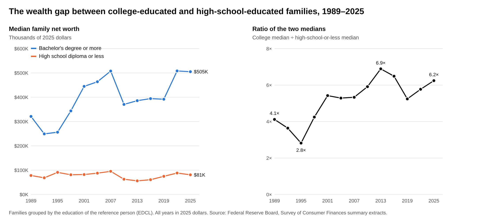

# College vs. high-school wealth gap, 1989–2025

How the net worth gap between US families headed by a college graduate and
families headed by someone with a high school education or less has changed
since 1989, using the Federal Reserve's Survey of Consumer Finances (SCF).



## The figure

`figures/networth_gap_by_education.png` shows, for each SCF wave from 1989 to 2025:

- **Left:** median family net worth for two groups:
  - **Bachelor's degree or more:** `EDCL` = 4.
  - **High school diploma or less:** `EDCL` = 1 or 2, combining no diploma with a diploma or GED.
- **Right:** the ratio of the two medians.

Families are grouped by the education of the SCF **reference person**, which is
usually the respondent. It is not the education of parents or children.
Families with some college or an associate degree (`EDCL` = 3) are left out.
All dollar values are in **2025 dollars**.

In 2025 the median was $505K for college families and $81K for high-school-or-less
families. That is a ratio of 6.2×, up from 4.1× in 1989. The 95% interval for the
college median is roughly $440K–$570K.

`figures/networth_gap_by_education_mean.png` is the same chart drawn with means
instead of medians, for comparison. Means are about four times higher, because
wealth is very skewed.

## Data

SCF Summary Extract Public Data, CSV version, one file per wave:
`https://www.federalreserve.gov/econres/files/scfp{YEAR}excel.zip`
([SCF home page](https://www.federalreserve.gov/econres/scfindex.htm)). The Fed
restates every wave in dollars of the latest survey, so no further inflation
adjustment is applied.

Each family appears five times in the extract, once per imputation. Following
the Fed, medians and means pool all five imputations, weighted by `WGT`. With
this method the results match the Fed's published historical table built from
the public data ("Table 4" in `scf2025_tables_public_real_historical.xlsx`)
exactly. The figures in the Fed's report differ slightly (about 0.1% for medians)
because the report uses the Fed's internal data.

`data/networth_by_education.csv` holds the results. It has one row per year and
education group, with the median, the mean, the share of families and the number
of families.

## Rerunning

Requires Python 3 with numpy, pandas and matplotlib.

```bash
pip install -r requirements.txt
python get_data.py           # downloads ~25 MB of zips to data/raw/ (~200 MB unpacked; ignored by git), writes the CSV
python plot.py               # median figure
python plot.py --stat mean   # mean figure
```

`get_data.py` skips years already in `data/raw/`. Delete that folder to download
everything again.

Note: the two PNGs committed here were not drawn by `plot.py`. matplotlib could
not be installed in the environment that built them, so they were drawn from the
same CSV with a stand-in SVG renderer. Running `plot.py` writes over them at the
same paths, with slightly different styling.
